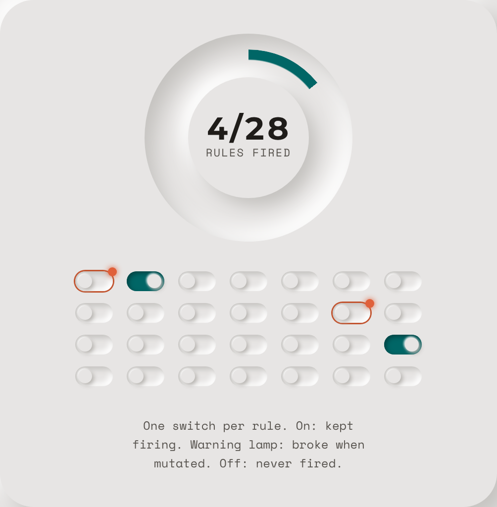
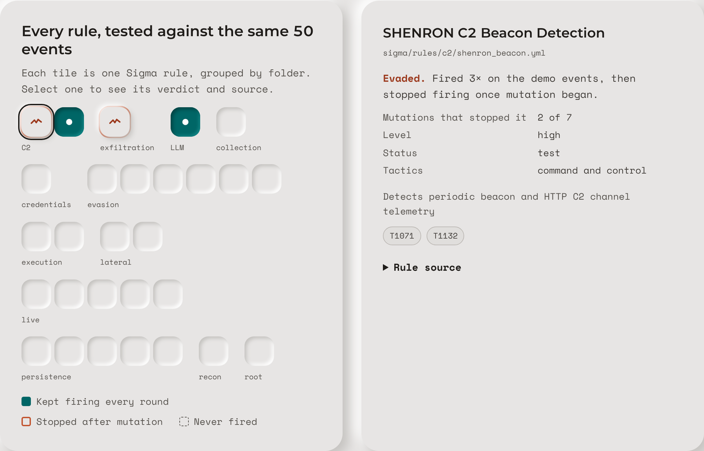
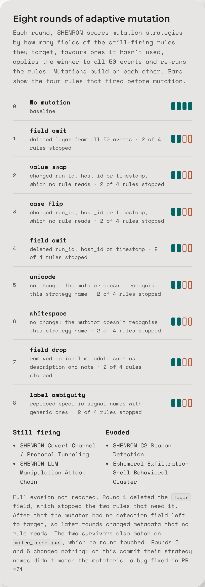

SHENRON used to rank my Sigma rules and six attack scenarios by how brittle they were. Two independent AI reviews (a separate review agent and a second model working from a written prompt) found that measurement was broken. Fixed, every scenario scores 0.00, and that proves nothing either.

This post covers what survived. I reran each claim in the [interactive report](https://gnomeman4201.github.io/shenron/report/) against the code, kept what held, withdrew what didn't, and listed what is still open.

**Repo:** [github.com/GnomeMan4201/shenron](https://github.com/GnomeMan4201/shenron)

*One switch per rule. On: kept firing through all 8 rounds. Warning lamp: stopped once mutated. Off: never fired. [Open the live report](https://gnomeman4201.github.io/shenron/report/).*

## What SHENRON measures

SHENRON generates synthetic telemetry: JSONL events that describe adversary behavior without performing it. It then runs Sigma rules against those events, mutates the events, and checks which rules still fire.

The report is one pinned run at commit `6810866`: 50 demo events, 28 rules, 8 rounds of mutation and 6 generated attack campaigns. It asks three questions:

1. Which rules fire on the demo events?
2. Does mutating the events stop them?
3. Which attack scenarios break detection most?

The first answer held up as reported. The second reproduced exactly but means less than it looked. The third was withdrawn.

*Every rule grouped by folder. Selecting one shows its verdict, metadata and full Sigma source.*

## What held up

Each finding below was rerun at `6810866` and again with the fixes from PR #71 applied, with different Python hash seeds. The numbers were identical every time.

| Finding | How it was checked |
| --- | --- |
| 4 of 28 rules fire on the 50 demo events: covert channel (7 hits), LLM manipulation (4), C2 beacon (3), exfil shell (3) | Rerun at both commits; both AI reviews also reproduced every hit count |
| 24 rules never fire on the demo events | Same reruns |
| Deleting one field, `layer`, stops 2 of those 4 rules (beacon and exfil shell) | Instrumented the mutator: round 1 deleted `layer` from all 50 events, and both rules stopped |
| The other 2 keep firing through all 8 rounds only because they also match `mitre_technique`, which no round touches | Both rules fire on `1 of selection_*` with a `mitre_technique` selection; no strategy targets that field |
| After round 1, the mutator had no detection field left to change. Rounds 2–4 changed `run_id`, `host_id` or timestamps, and rounds 5–6 changed nothing | Same instrumentation; rounds 5–6 used strategy names the mutator didn't recognise |
| ATT&CK overlap: 20 techniques appear in both events and rule tags, 10 only in events, 20 only in rule tags | Recomputed at the parent-technique level |

*Each round lists what it actually changed. Only round 1 touched a field any rule reads.*

Put plainly: on this data, the rules fire because they match labels the simulator writes into each event, not observable behavior. Mutation measured which rules depend on one of those labels.

## What I withdrew

The scenario ranking is gone. It put apt29-style first at 0.71 brittleness and ransomware-precursor last at 0.40. The campaign scorer that produced it had four defects:

- **Mismatched comparison.** Before mutation, the scorer checked every event in a stage; after mutation, only the single mutated event. If a rule was still firing on a sibling event, that counted as an evasion. Each stage has 3 to 13 events, and fixing this one defect alone takes all six scenarios to 0.00.
- **Undetected stages counted as evasion.** A stage no rule detected in the first place still scored as "evaded" after mutation.
- **Only one field was mutated.** The mutator loaded only the top-level rule files, so the only detection field it ever changed was `layer`.
- **Seeds changed between runs.** Mutation seeds came from Python's `hash()`, which differs per process. Separately, the first run in a fresh environment gave apt29-style 0.71, and later runs give 0.67.

With all four fixed in [PR #71](https://github.com/GnomeMan4201/shenron/pull/71), all six scenarios score 0.00 in three separate runs.

The headline strategy number went with it. The report said value swap evaded detection 58% of the time. That 0.58 was the mean brittleness of the six scenarios, and four strategies were tied for "most effective".

The first version of the interactive report also overstated two things: it said every mutation round targeted `layer` (only round 1 did), and it called each event's safety fields a "contract". Both are corrected in the version linked here.

0.00 is not good news. The rules still match labels that no mutation changes, so in this setup mutation can't break them. A durability score of zero here means the test can't fail, not that the rules are robust.

## What's still unresolved

- **Synthetic only.** Everything here is SHENRON's own simulated events. None of it says how these rules perform on real logs.
- **Label matching.** The rules key on fields the simulator assigns, such as `layer`, `mitre_technique` and `behavior_class`. None of them is shown to exist in real telemetry; a pipeline would have to add them through enrichment.
- **No durability measurement yet.** The mutation rounds only ever changed one detection field. They show which rules depend on `layer`, not how rules hold up against real attacker variation.
- **Self-reported safety flags.** 40 events carry a safety object (no executable, no network connection, simulation only), and the other 10 carry fewer fields. The generator writes these flags. They are not an audit of what the tool did at runtime.
- **A pinned, unmerged snapshot.** The report is fixed at `6810866`. The fixes in PR #71 and the pilot in PR #72 are still drafts, and the report needs regenerating once they merge.
- **The fix is a two-rule pilot.** [PR #72](https://github.com/GnomeMan4201/shenron/pull/72) rewrites the two C2 rules to match simulated observables (`*_sim` fields) instead of labels. It covers two of 28 rules, its numbers are early and unreviewed, and it found a new gap: the pySigma bridge doesn't normalize Unicode, so homoglyph mutations slip past.

## Next, and where to look

Next I'll merge the measurement fixes, extend observable-field rules beyond C2, and regenerate the report from the merged code. A durability claim comes back only when a rule can be shown to fail under mutation and the score explains why.



- [Interactive report](https://gnomeman4201.github.io/shenron/report/): every rule, round, scenario and event, with the source of each rule
- [Claim-by-claim verification](https://github.com/GnomeMan4201/shenron/blob/main/docs/report/VERIFICATION.md): what was rerun and what each claim rests on
- [PR #71](https://github.com/GnomeMan4201/shenron/pull/71): measurement fixes
- [PR #72](https://github.com/GnomeMan4201/shenron/pull/72): observable-field pilot for the C2 rules
- [Repo](https://github.com/GnomeMan4201/shenron)

If you find a number in the report that doesn't reproduce, open an issue with the command you ran.
